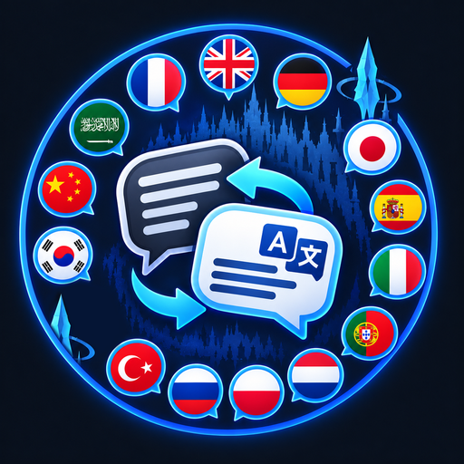

<p align="center">
  
</p>

# Chat Translator (Dalamud plugin for FFXIV)

Automatically detects the language of every chat message and replaces it with a translation in the language of your choice. Messages already written in your chosen language are left untouched.

An English message "Hi, does anyone want to run a dungeon?" is displayed with a French target as:

```
[EN→FR] Salut, quelqu'un veut faire un donjon ?
```

The settings window, the command help and the plugin messages follow your **game language** (English, French, German or Japanese). English is used by default for any other language, and you can pick the interface language manually in the settings.

## Features

- **Automatic language detection**: the translation service detects the source language of each message.
- **Choose your target language**: French, English, German, Japanese, Spanish, Italian, Portuguese, Dutch, Polish, Russian, Turkish, Korean, Chinese (simplified) or Arabic.
- **Replace the original message**: the translation takes the place of the original line in the chat. Disable this option to get the translation on a separate line below the original instead.
- **See the original**: click the `[EN→FR]` tag of a translated message to show the original text in a tooltip above the mouse. (Dalamud cannot detect hovering over native chat lines, so this is click-based. The last 256 translated messages keep their original.)
- **Per-channel control**: Say, Shout, Yell, Party, Cross-world party, Alliance, Free Company, incoming tells, Linkshells and Cross-world Linkshells. Say is disabled by default.
- **Translate your own messages**: `/htranslate` opens a small window where you write a message, choose the language to translate it to, and copy the result to the clipboard to paste it in the chat. The source language is detected automatically and nothing is sent to the game automatically.
- **Ignored languages**: e.g. `en` if you already understand English.
- **Two services**: Google Translate (free, no key) or DeepL Free (requires a free API key).
- Messages are cached to avoid translating the same text twice.

## How it works

- The plugin listens to `IChatGui.ChatMessage`.
- If a translation is already cached, the message text is replaced immediately. Otherwise the message is held for a moment, translated, then displayed in its original place. Message order is preserved. If the translation fails or takes more than 4 seconds, the original message is shown.
- Translated messages are displayed locally on your client only. Nothing is sent to the game server and other players never see the translation.

## Privacy

The text of the messages in the channels you enabled is sent to **Google Translate** (default) or **DeepL** (if selected) in order to be detected and translated. Disable the channels you do not want to send, and do not use the plugin if you are not comfortable with this. Your DeepL API key, if any, is stored only in your local plugin configuration.

## Install (custom repository)

1. In game, type `/xlsettings` and open the **Experimental** tab.
2. In **Custom Plugin Repositories**, paste this URL, click the **+** button, then **Save and Close**:

   ```
   https://raw.githubusercontent.com/heiwaastralis/XIVChatTranslator/main/repo.json
   ```

3. Type `/xlplugins`, search for **Chat Translator** in the plugin installer and click **Install**.

## Usage

- `/frtrad`: open the settings window.
- `/frtrad on` / `/frtrad off`: enable / disable the translation.
- `/htranslate`: open the window to translate your own messages (then paste the copied result into the chat yourself).

Note: for incoming tells, a message that has to be translated is held and re-displayed, so the usual tell sound or flash may not trigger for translated tells. Uncheck "Incoming tells" or disable "Replace the original message" if this bothers you.

## Build

Requirements: the **.NET 10 SDK** and XIVLauncher with Dalamud installed (launch the game once so that `%AppData%\XIVLauncher\addon\Hooks\dev` exists).

```
dotnet build -c Release
```

The DLL is generated in `bin\Release\` (usually in a `net10.0-windows` subfolder).

> **API level**: the `.csproj` uses `Dalamud.NET.Sdk/15.0.0`. If your Dalamud uses another API level, change this number to match the official [SamplePlugin](https://github.com/goatcorp/SamplePlugin). The chat event signature (`IHandleableChatMessage`) comes from the current Dalamud API and may change in future versions.

## Install as a dev plugin

1. In game, type `/xlsettings` and open the **Experimental** tab.
2. In **Dev Plugin Locations**, add the full path of `FrenchChatTranslator.dll` (the `FrenchChatTranslator.json` manifest must be next to it), then **Save and Close**.
3. Type `/xlplugins`, open **Dev Tools → Installed Dev Plugins** and enable **Chat Translator**.

After rebuilding, disable and re-enable the plugin in **Installed Dev Plugins** to load the new DLL.

## Versioning and changelog

The version number is defined in one place: `<Version>` in `FrenchChatTranslator.csproj` (currently `1.0.0.0`). It is shown in the settings window. To release a new version, change that number, add a section to [`CHANGELOG.md`](CHANGELOG.md) and rebuild. The project follows [Semantic Versioning](https://semver.org/).

## License

[MIT](LICENSE) © 2026 Heiwa

## Known limitations

- The Google endpoint used is public but unofficial and may be rate-limited or changed at any time. DeepL Free (500,000 characters/month) is more reliable.
- Very short or mixed-language messages (e.g. "gg", "ty") are often detected incorrectly. Adjust the minimum length in the settings.
- A translated message contains only the translated text: item links and similar elements from the original message are not kept.
- Translations of the interface into German and Japanese were not reviewed by native speakers. Corrections are welcome in `Loc.cs`.
